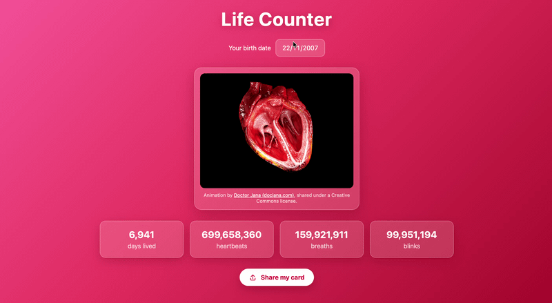

# life-in-numbers-
# Life in Numbers

Enter your birth date and see your life in numbers: days lived, heartbeats, breaths and blinks, ticking up live. Then turn it into a shareable card.

**Live demo:** https://ezzzzz7777.github.io/life-in-numbers-/

<!-- Add a screenshot or GIF of the page here, for example: -->


## Features

- **Live counters** for days lived, heartbeats, breaths and blinks, updating several times a second
- **Milestone days**, such as when you reached (or will reach) 1,000, 5,000 or 10,000 days
- **Share card**: one click creates a pink-and-red image with your days lived and the three counters, and nothing else. Your birth date is never on it. On phones it opens the share sheet; on computers it downloads a PNG
- **Remembers you**: your birth date is saved in your own browser, so the counters are ready next time
- **Responsive design** that works on phones, tablets and desktops
- **Animated beating heart** at the top of the page

## How the numbers are estimated

All counts are estimates based on average resting rates, not measurements:

| Counter | Rate used |
| --- | --- |
| Heartbeats | about 70 per minute |
| Breaths | about 16 per minute |
| Blinks | about 15 per minute while awake, assuming 16 waking hours a day |

Days lived is the exact number of days between your birth date and now. Milestone dates are your birth date plus 1,000, 5,000, 10,000, 15,000, 20,000, 25,000 and 30,000 days.

## Built with

- HTML, CSS and vanilla JavaScript (no frameworks or build tools)
- Canvas API to draw the share card
- Web Share API, with a download fallback
- `localStorage` to remember the birth date
- GitHub Pages for hosting

## Skills practiced

- DOM manipulation and event handling
- Date and time maths in JavaScript
- Drawing and exporting images with the Canvas API
- CSS Grid, gradients and responsive layout
- Saving data in the browser with `localStorage`
- Publishing a static site with GitHub Pages

## Run it locally

1. Download or clone this repository.
2. Open `index.html` in your browser. No installation is needed.

For automatic refresh while you edit, open the folder in VS Code and use the Live Server extension.

## Project structure

```
life-counter/
  index.html       page structure
  style.css        styling and layout
  script.js        counters, milestones and share card
  heart-only.gif   animated heart
  README.md
```

## Privacy

- Your birth date stays in your own browser. It is never sent to a server.
- The share card contains only the numbers, so sharing it does not reveal your birth date.

## Credits

- Heart animation by [Doctor Jana](https://docjana.com/cardiac-cycle/), shared under a Creative Commons license. Please check the license terms on the original page before reusing it.

## Notes

This project is for fun and learning. The numbers are rough estimates and are not medical information.
